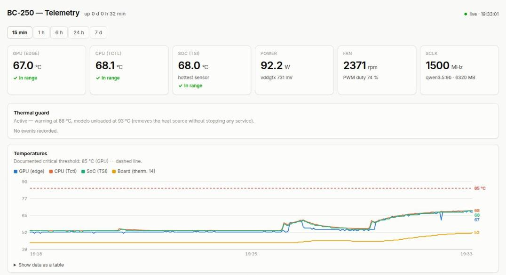

# bc250-monitor

*[Version française](README.fr.md)*

A lightweight thermal and performance dashboard for the **AMD BC-250** (the
ex-mining board built around a cut-down PS5 APU), with a built-in **thermal guard**
for machines running local LLMs through [Ollama](https://ollama.com).

- **Zero dependencies** — a single Python file using only the standard library, ~15 MB of RAM
- Samples sensors every 3 s, stores them in SQLite, keeps 14 days of history
- Web dashboard with temperatures, GPU power, GPU clock, fan speed and PWM duty
- **Thermal guard**: logs a warning at 88 °C and **unloads Ollama models from VRAM**
  at 93 °C, cutting the heat source without stopping any service
- Peaks are never hidden: when zoomed out, each chart point keeps the *maximum*
  temperature and power of the samples it covers
- Light and dark themes, accessible status badges (icon + label, never colour alone),
  and a table view of the data



## Why

The BC-250's stock cooling is marginal. Under sustained LLM inference the SoC can
climb past 100 °C, and the board's sensors are spread across three drivers
(`amdgpu`, `k10temp`, and the Nuvoton Super I/O). This tool puts them on one page,
keeps a history to correlate heat with load, and steps in before things get
dangerous.

## Requirements

- An AMD BC-250 running Linux with `systemd` and Python ≥ 3.8
- The **Nuvoton NCT6686D** Super I/O exposed to `hwmon`. It is not detected by
  default; force the in-kernel `nct6683` driver (read-only, which is all this tool
  needs):

  ```sh
  echo "options nct6683 force=true" | sudo tee /etc/modprobe.d/nct6683.conf
  echo "nct6683"                    | sudo tee /etc/modules-load.d/99-sensors.conf
  sudo modprobe nct6683 force=true
  ```

  The out-of-tree [`nct6687d`](https://github.com/Fred78290/nct6687d) driver also works.
- Optional: Ollama on the same machine, for the thermal guard and the loaded-model display.

Check that the sensors are visible:

```sh
sensors | grep -iE "edge|Tctl|TSI|fan2|PPT"
```

## Install

```sh
git clone https://github.com/bcyr/bc250-monitor.git
cd bc250-monitor
sudo ./install.sh
```

Then open `http://<bc250-address>:9095`.

The service runs as an unprivileged dynamic user and stores its database in
`/var/lib/bc250-monitor/metrics.db`.

To try it without installing: `python3 monitor.py` (the database is then created
next to the script).

## Configuration

Set environment variables in `/etc/default/bc250-monitor`, then
`sudo systemctl restart bc250-monitor`.

| Variable | Default | Meaning |
|---|---|---|
| `BC250_MON_PORT` | `9095` | HTTP port |
| `BC250_MON_BIND` | `0.0.0.0` | Listen address — use `127.0.0.1` to keep it local |
| `BC250_MON_INTERVAL` | `3` | Seconds between samples |
| `BC250_MON_RETENTION_DAYS` | `14` | History kept |
| `BC250_MON_DB` | *(see above)* | Path to the SQLite database |
| `BC250_OLLAMA_URL` | `http://127.0.0.1:11434` | Ollama API |
| `BC250_GUARD` | `1` | `0` disables the thermal guard |
| `BC250_GUARD_WARN` | `88` | Warning threshold, °C |
| `BC250_GUARD_CRIT` | `93` | Unload threshold, °C |

## Thermal guard

On every sample the guard takes the hottest of GPU edge, CPU Tctl and SoC TSI.

- At or above `BC250_GUARD_WARN`, it logs a warning event (once, until the
  temperature falls 3 °C below the threshold).
- At or above `BC250_GUARD_CRIT` for **2 consecutive samples**, it asks Ollama to
  unload **every** loaded model (`keep_alive: 0`), then waits 120 s before it can
  trip again.

Unloading frees the GPU almost instantly. The next request reloads the model, so
nothing needs restarting. Events appear on the dashboard and in
`journalctl -u bc250-monitor`.

The guard is a safety net, not a substitute for adequate cooling.

## Sensors

| Field | Source |
|---|---|
| GPU edge, power (PPT), VDDGFX | `amdgpu` hwmon |
| GPU clock (SCLK) | `pp_dpm_sclk` of the amdgpu DRM device |
| CPU Tctl | `k10temp` |
| SoC TSI, board thermistors 14/15, fan2 speed, pwm2 duty | `nct6686` / `nct6687` |
| NVMe | `nvme` |

`hwmon` paths are resolved **by name**, since the `hwmonN` numbering changes
between boots, and re-resolved if a sensor disappears (for example after a module
reload). Missing sensors simply show as `—`.

## API

All endpoints are `GET` and return JSON.

| Endpoint | Returns |
|---|---|
| `/api/current` | A fresh sample, the loaded Ollama models and uptime |
| `/api/history?range=15m\|1h\|6h\|24h\|7d` | Up to 420 points per series |
| `/api/events` | The last 50 guard events |
| `/api/health` | Guard state, thresholds, sampling interval, retention |

## Security

The dashboard has **no authentication** and listens on all interfaces by default.
It exposes read-only telemetry, and its API cannot change anything on the machine.
Even so, keep it on a trusted network, set `BC250_MON_BIND=127.0.0.1` and put it
behind a reverse proxy, or firewall the port.

## Related

- [AMD BC-250 documentation](https://elektricm.github.io/amd-bc250-docs/) — hardware, sensors, cooling, GPU governor
- [bc250-ollama-openwebui](https://github.com/thelamer/bc250-ollama-openwebui) — Ollama + Open WebUI setup for the BC-250

## License

[MIT](LICENSE)
